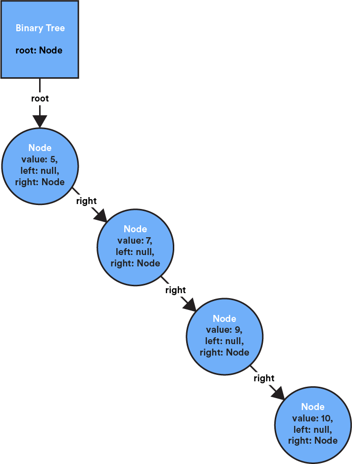
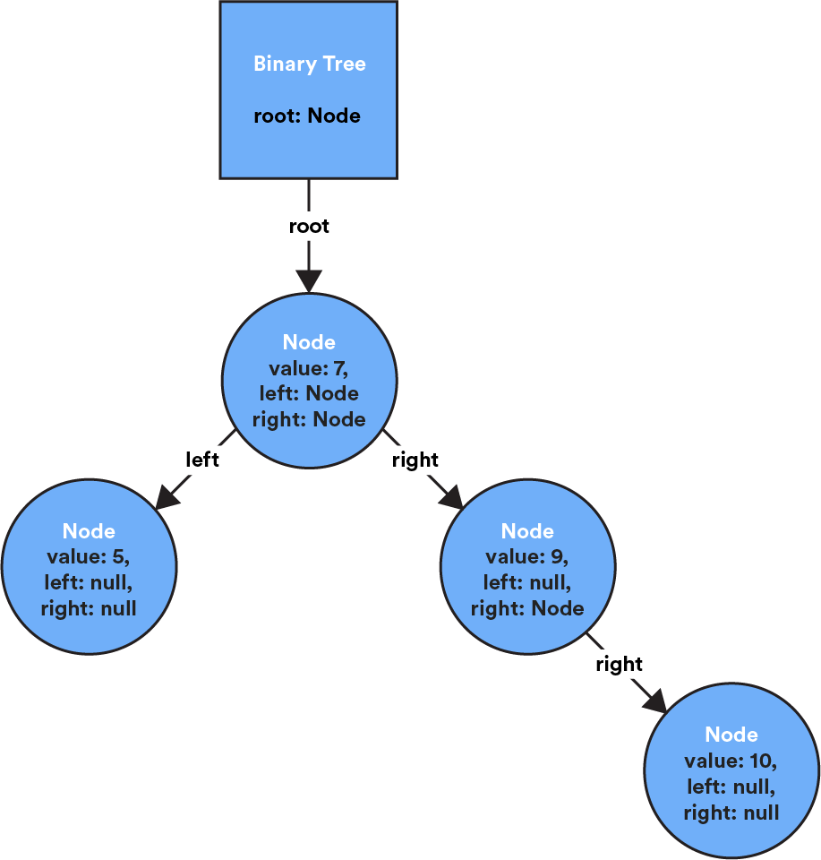
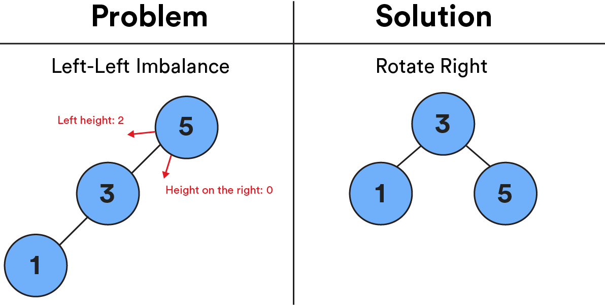
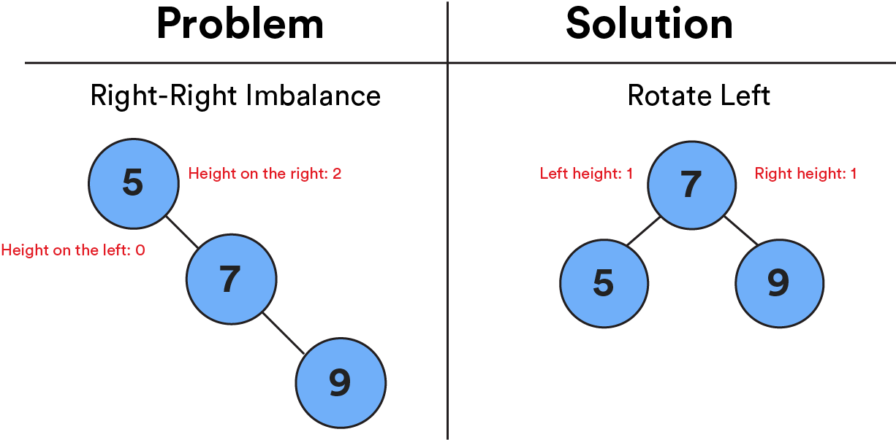
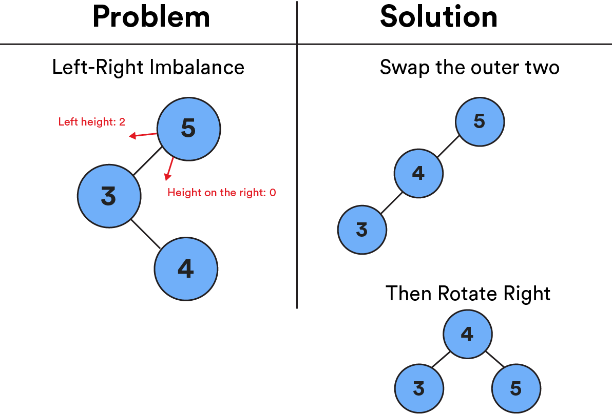
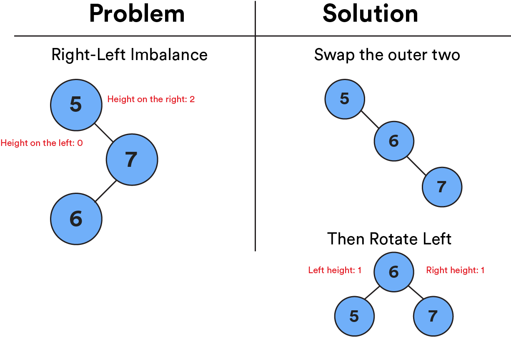

# 

In our last lesson, we heard about the efficiency and power of binary trees. But, similar to us humans, binary trees are only at their best when things are balanced. In this lesson, we’ll learn about how to unlock the power of binary trees by balancing them!

## You Hate to See That Happen

If we kept adding nodes to a tree that were greater than the previous node, they’d all move to the right. Eventually, this would give us a huge right side with nothing on the left. No one wants to see that happen! This tree has lost its balance.

At this point, our super-efficient binary tree is basically just a giant linked list, meaning that we’ve lost all of the efficiency gains that come along with a tree structure.

 

## Much Better

If our tree was better balanced, it would look something like this. The left and right sides are nearly the same length — as close as we can get, at least — making this tree balanced. Much better! We can now use search and insertion methods that cut the tree in half each time, getting us back to efficient `O(log(N))` complexity.

Notice how this tree became balanced. Instead of having the value `5` as the top node, we now have `7` at the top, with the other nodes in place on either side. This process of moving the nodes around on a tree until we find balance is called **rotating**.

 

## The Self-Balancing Tree

We’re going to focus on one important type of tree that has realized the self-balancing dream: **an AVL tree** (named after its inventors, Adelson-Velsky and Landis).

An AVL tree balances itself by automatically calculating the difference in heights — the number of levels — between the left and right sides:

- Difference is `0` or `1`: The tree is balanced!
- Difference is more than `1`: The tree is unbalanced.

In our balanced binary tree below, the left side has a height of `1`, while the right side has a length of `2`. The difference is only `1`, which makes it balanced

 

## Finding the Height

Knowing the height of an AVL tree is important — this is what allows the tree to balance itself!

In many implementations of an AVL tree, the height of a given node is stored as a property within the node itself, just like it stores `left` and `right` properties that point to its child nodes.

The height of a given node is the **longest possible path forward** in the tree before reaching a leaf node (the end of the tree). You can use the `setHeight` method to do this work for you!

## How an AVL Tree Balances Itself

Let’s get back to fixing the problem of balance with rotation.

Adding a new node to an AVL tree can either keep it balanced or throw it off balance. There are four scenarios for what this imbalance could look like:

- **Left-left** imbalance
- **Left-right** imbalance
- **Right-right** imbalance
- **Right-left** imbalance

These can all be resolved with rotation, but they involve different steps.

## Fixing the Imbalance

### Left-Left Imbalance

1. Rotate everything to the right.

 

### Right-Right Imbalance

1. Rotate everything to the left.

 

### Left-Right Imbalance

1. Swap the outer two nodes.
2. Rotate everything to the right.

 

### Right-Left Imbalance

1. Swap the outer two nodes.
2. Rotate everything to the left.

 

## Visualize It

Want to try your hand at balancing an AVL tree in real time? Check out [this visualization tool](https://www.cs.usfca.edu/~galles/visualization/AVLtree.html) from the University of San Francisco. You can add nodes in the “insert” input in the upper-left part of the screen and watch as the tree balances itself!

## Let’s Talk About Interviews

In a job interview, you may be asked to check if a binary tree is balanced or balance an unbalanced tree. (That would be a pretty hardcore interview!)

Here’s what those problems could look like:

- [Convert a normal tree to a balanced one](https://www.geeksforgeeks.org/convert-normal-bst-balanced-bst/).
- [Determine if a binary tree is balanced](https://www.geeksforgeeks.org/how-to-determine-if-a-binary-tree-is-balanced/).
- [Whiteboard an AVL tree](https://www.youtube.com/watch?v=rbg7Qf8GkQ4&).

 

